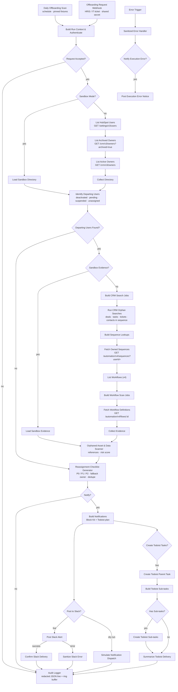

# n8n-hubspot-user-permission-offboarding-sanitizer

**An offboarding security audit for HubSpot.** It finds deactivated, suspended and unassigned users, checks what they still own or are still referenced by (active workflows, sales sequences, open deals, open tasks and tickets), and turns the findings into a prioritised reassignment checklist in Slack and Todoist.

Built by DH Robin · dhRobin Systems · Revenue infrastructure architecture

> **Safe by default.** The workflow ships with `SANDBOX_MODE=true` and `DRY_RUN=true`. In that state it makes no HubSpot API calls, posts nothing to Slack and creates no Todoist tasks. The full audit still runs against pinned, fictional fixtures. The workflow is **read-only towards HubSpot** in every mode. It recommends reassignments; a person makes them.

---

## Table of Contents

1. [Why this exists](#1-why-this-exists)
2. [Architecture](#2-architecture)
3. [Repository layout](#3-repository-layout)
4. [Quick start](#4-quick-start)
5. [HubSpot Users & Owners API endpoints & scopes](#5-hubspot-users--owners-api-endpoints--scopes)
6. [Departing-user detection](#6-departing-user-detection)
7. [Orphan discovery logic](#7-orphan-discovery-logic)
8. [Reassignment checklist & fallback owners](#8-reassignment-checklist--fallback-owners)
9. [Slack & Todoist payload structures](#9-slack--todoist-payload-structures)
10. [Environment variables](#10-environment-variables)
11. [Node configuration](#11-node-configuration)
12. [Testing stages](#12-testing-stages)
13. [Security model](#13-security-model)
14. [Troubleshooting](#14-troubleshooting)
15. [Known limitations](#15-known-limitations)
16. [Disclaimer & license](#16-disclaimer--license)

---

## 1. Why this exists

When a rep leaves, HubSpot deactivates the login, but their footprint stays. In offboarding reviews I keep finding the same leftovers:

- **Lead rotations still include the departed user,** so new leads are assigned to someone who will never call them.
- **Internal notifications and task assignments** in workflows point at a deactivated user and fail or skip without anyone noticing.
- **Contacts stay enrolled in sequences** that send from a mailbox nobody is watching, or that stop when the mailbox is disconnected.
- **Open deals and tickets** keep the old owner. Forecasts, SLAs and customer replies quietly stall.
- **Overdue tasks** pile up on an owner who will never complete them.

This workflow runs daily, or on demand from an HRIS or IT ticket webhook. It finds those leftovers and hands RevOps a checklist ordered by urgency.

---

## 2. Architecture



**Design principle: the sandbox and live paths converge before the logic.** Sandbox fixtures are shaped exactly like the live API results. *Identify Departing Users*, the *Scanner*, the *Checklist Generator* and *Build Notifications* therefore run the same code in every mode. Only the fetchers differ.

---

## 3. Repository layout

```text
n8n-hubspot-user-permission-offboarding-sanitizer/
├── README.md        # This guide
├── workflow.json    # Importable n8n workflow (45 nodes incl. 3 sticky notes, pinned fixtures)
├── DISCLAIMER.md    # Liability limitation & open-source notice
└── LICENSE          # MIT License
```

---

## 4. Quick start

1. In n8n, go to **Workflows → Import from File** and choose `workflow.json`.
2. Leave every environment variable unset. Sandbox mode and dry run apply.
3. Select the **Daily Offboarding Scan** trigger and click **Execute workflow**. It uses its pinned fixtures.
4. Compare the **Audit Logger** output with the [expected results](#stage-1--sandbox-pinned-fixtures-no-network).
5. Open **Simulate Notification Dispatch (Dry Run)**. Paste `slackMessage.blocks` into Slack's Block Kit Builder, and look at `todoistPlan` to see the tasks that would be created.
6. In **Workflow settings → Error Workflow**, select this workflow so the Error Trigger branch handles failures.

### n8n platform prerequisites

| Setting | Why |
|---|---|
| `N8N_BLOCK_ENV_ACCESS_IN_NODE=false` | Configuration is read from `$env`. Recent n8n versions block env access by default. If access stays blocked, every Code node falls back to sandbox mode and dry run. |
| `NODE_FUNCTION_ALLOW_BUILTIN=crypto` | Used for constant-time webhook secret comparison and run IDs. A slower fallback exists. |
| Concurrency 1 for this workflow | The report-dedupe ledger lives in workflow static data, which isn't transactional. |

The node versions used are Schedule Trigger v1.2, Webhook v2, Code v2, IF v2.2 and HTTP Request v4.2 (with pagination and batching).

---

## 5. HubSpot Users & Owners API endpoints & scopes

Every HubSpot call is a **GET** or a **search POST**. Nothing is written to HubSpot.

| Purpose | Endpoint | Scope |
|---|---|---|
| Active users, roles, teams | `GET /settings/v3/users?limit=100&after=…` | `settings.users.read` |
| Deactivated users | `GET /crm/v3/owners?archived=true&limit=500&after=…` | `crm.objects.owners.read` |
| Active owners, teams | `GET /crm/v3/owners?limit=500&after=…` | `crm.objects.owners.read` |
| Open deals | `POST /crm/v3/objects/deals/search` | `crm.objects.deals.read` |
| Open tasks | `POST /crm/v3/objects/tasks/search` | Check the scope on the tasks API page for your app type (engagement objects have used `crm.objects.contacts.read`) |
| Open tickets | `POST /crm/v3/objects/tickets/search` | `tickets` |
| Contacts currently in a sequence | `POST /crm/v3/objects/contacts/search` | `crm.objects.contacts.read` |
| Sequences owned by a user | `GET /automation/v4/sequences?userId=…&limit=100` | `automation.sequences.read` |
| Workflow inventory | `GET /automation/v4/flows?limit=100&after=…` | `automation` |
| Workflow definitions | `GET /automation/v4/flows/{flowId}` | `automation` |

### Facts the detection relies on

- **The Users API has no status field.** Deactivated users are found through the **Owners API with `archived=true`**. For an archived owner, `userId` is `null` and the user ID is in `userIdIncludingInactive`.
- The owner `updatedAt` timestamp tracks changes to the owner object, not the user. I use it as the best available approximation of the deactivation date (`DEACTIVATION_LOOKBACK_DAYS`). Use `INCLUDE_ALL_ARCHIVED_OWNERS=true` for a one-off backfill.
- **The sequences list requires a `userId`**, so it's called once per departing user. HubSpot also requires a Sales Hub or Service Hub Professional/Enterprise seat for this API. A 4xx answer becomes a *scan gap* in the checklist, never a silent zero.
- **The v4 workflows list returns only key fields,** so each definition is fetched and scanned. Community reports say some flows (for example ones with certain edit-record actions) can be missing from the v4 list. Treat workflow coverage as best-effort and see [limitations](#15-known-limitations).

### Private app setup

Create a private app with **only** these read scopes: `settings.users.read`, `crm.objects.owners.read`, `crm.objects.deals.read`, `crm.objects.contacts.read`, `tickets`, `automation`, `automation.sequences.read`, plus the tasks scope your account requires. Don't add any write scopes.

---

## 6. Departing-user detection

| Status | Signal | Why it matters |
|---|---|---|
| `deactivated` | Archived owner updated inside `DEACTIVATION_LOOKBACK_DAYS` (30) | Login is gone, assets are orphaned |
| `pending_offboarding` | Named in a webhook request or `OFFBOARDING_USER_EMAILS` / `OFFBOARDING_USER_IDS`, still active | Last chance to transfer before access is removed. A **user access** P0 item is added. |
| `suspended_or_unlinked` | Active owner whose `userId` is missing from the Users API | Owner still assignable, but no working login behind it |
| `unassigned_user` | Active user with no role, no team and not a super admin | A limbo account that often belongs to someone who left |

Requests can identify a person by `email`, `userId` or `ownerId`. Unmatched requests are counted in `directorySummary.unmatchedRequests` (masked). `IGNORE_OWNER_IDS` excludes service accounts. `MAX_DEPARTING_USERS_PER_RUN` (25) caps the fan-out.

If the Users API or either Owners call fails, the run produces a **critical "scan failed" report**. An unreadable directory is never treated as "nobody left".

---

## 7. Orphan discovery logic

### 7.1 CRM searches (per departing owner)

Each search returns HubSpot's `total`, plus up to `SEARCH_SAMPLE_LIMIT` (25) records for the checklist examples.

| Asset | Filter |
|---|---|
| Open deals | `hubspot_owner_id = ownerId` **and** `hs_is_closed = false`. If `DEAL_CLOSED_STAGE_IDS` is set, `dealstage NOT_IN [...]` is used instead. |
| Open tasks | `hubspot_owner_id = ownerId` **and** `hs_task_status ≠ COMPLETED` |
| Open tickets | `hubspot_owner_id = ownerId` **and** `closed_date` not set. If `TICKET_CLOSED_STAGE_IDS` is set, `hs_pipeline_stage NOT_IN [...]` is used instead. |
| Contacts in sequences | `hubspot_owner_id = ownerId` **and** `hs_sequences_is_enrolled = true` (configurable as `CONTACT_SEQUENCE_ENROLLED_PROPERTY`). Contact **IDs only** are collected. |

Flags computed from the sample:

- **Deal at risk:** close date within `DEAL_CLOSING_SOON_DAYS` (30) **or** amount ≥ `HIGH_VALUE_DEAL_AMOUNT` (50,000).
- **Overdue task:** `hs_timestamp` in the past. The count is taken from the sample, which is noted when `total` is larger than the sample.
- **High-priority ticket:** `hs_ticket_priority` is in `HIGH_PRIORITY_TICKET_VALUES` (`HIGH,URGENT`).

Before going live, check that `hs_is_closed`, `closed_date` and `hs_sequences_is_enrolled` exist in your portal (Settings → Properties). If one doesn't, that search returns 400 and shows up as a scan gap.

### 7.2 Workflow reference scan

Every workflow definition (enabled first, up to `MAX_WORKFLOWS_TO_SCAN` = 300) is walked recursively. A value counts as a reference when:

1. it **equals the departing owner ID or user ID**, **and** its path contains `owner`, `user`, `assign`, `recipient`, `notif`, `rotat`, `sender`, `cc` or `email`, **or** the surrounding object names an owner property (such as `hubspot_owner_id`); **or**
2. it **contains the departing user's email address**.

Matching on the path stops numeric IDs from matching unrelated values. Each reference is classified:

| Kind | Typical source |
|---|---|
| `owner_rotation` | Rotate-record-owner actions |
| `internal_notification` | Internal email or in-app notification recipients |
| `task_assignment` | Create-task actions assigned to the user |
| `owner_assignment` | Set-owner actions |
| `enrollment_filter` | Enrollment criteria filtering on this owner |
| `email_reference` | Hard-coded email address |
| `user_reference` | Anything else that matches |

Enabled workflows are **P0**; disabled workflows are **P2**, so they get fixed before anyone turns them back on.

### 7.3 Risk score

```text
score = 25 × enabled workflow hits + 3 × disabled workflow hits
      + (contacts in sequences > 0 ? 20 + min(20, ⌈n/5⌉) : 0)
      + 10 × deals at risk (closing soon) + 10 × deals at risk (high value)
      + min(20, 2 × open deals) + min(10, overdue tasks)
      + 5 × high-priority tickets + min(10, open tickets)
      + min(5, ⌈open tasks/5⌉) + (owned sequences > 0 ? 3 : 0)
      + (pending_offboarding ? 5 : 0)

tier: critical ≥ 60 · high ≥ 30 · medium ≥ 10 · low > 0 · none = 0
```

If any evidence source failed, the tier is raised to at least `medium`. An incomplete scan is never reported as clean.

---

## 8. Reassignment checklist & fallback owners

| Priority | Due | Items |
|---|---|---|
| **P0** | today | Enabled workflows referencing the user · contacts still in sequences · deals at risk · user still active (pending offboarding) |
| **P1** | 3 days | Other open deals · open tickets · overdue tasks · scan gaps |
| **P2** | 7 days | Other open tasks · sequences owned by the user (clone or share) · disabled workflows referencing the user |

Each item has `priority`, `assetType`, `count`, `title`, `action`, `recommendedOwner`, `hubspotLink` and up to 5 `sample` lines.

### Fallback owner resolution

1. `FALLBACK_OWNER_MAP` (JSON, for example `{"YOUR_TEAM_ID":"YOUR_FALLBACK_OWNER_ID"}`) keyed by the departing user's **primary team**.
2. Otherwise, the first active owner on the **same primary team**, alphabetically. This is marked as a *suggestion* to confirm with the team lead.
3. Otherwise, `DEFAULT_FALLBACK_OWNER_ID`.
4. Otherwise, `manual_selection_required`.

A mapped or default fallback owner who isn't an active user gets a `warning`, so work is never handed to another departed account.

### Report dedupe

Each report gets a fingerprint such as `deals:7|tasks:12|tickets:0|seqContacts:34|sequences:3|workflows:3`. Scheduled runs **suppress** a report whose fingerprint hasn't changed within `REPORT_COOLDOWN_HOURS` (72). Once someone starts reassigning, the counts change and the next report goes out. Webhook requests always notify. Users with no findings are `clean` and aren't notified unless `NOTIFY_ON_CLEAN=true`.

| State mode | Ledger |
|---|---|
| Sandbox | Seeded from fixture `priorReports` |
| Dry run | Read-only copy of the real ledger |
| Live | Workflow static data (`hsOffboardingSanitizer.reports`) |

---

## 9. Slack & Todoist payload structures

`NOTIFY_CHANNELS` (default `slack,todoist`) selects the channels. Both payloads are built from the same report.

### 9.1 Slack Block Kit (incoming webhook)

The channel is fixed by the webhook, so no channel ID is stored anywhere.

| # | Block | Content |
|---|---|---|
| 1 | `header` | `🔴 Offboarding audit · {name}` (the icon follows the risk tier) |
| 2 | `section` (optional) | `SLACK_MENTION_ON_CRITICAL` on critical reports |
| 3 | `section.fields` | Status, risk tier and score, owner ID / user ID, team, masked email, fallback owner |
| 4 | `section` | Counts: active workflows, contacts in sequences, open/at-risk deals, tickets, tasks |
| 5 | `divider` | — |
| 6–8 | `section` | P0, P1, P2 items with deep links and actions (up to 8 per tier) |
| 9 | `context` | Scan-gap warning, when present |
| 10 | `actions` | **Open user management** button |
| 11 | `context` | Run ID, trigger, mode |

Trimmed example (fixture user Jordan Vale):

```json
{
  "text": "CRITICAL: offboarding audit for Jordan Vale (Deactivated). 4 P0, 2 P1, 3 P2 actions.",
  "blocks": [
    { "type": "header", "text": { "type": "plain_text", "text": "🔴 Offboarding audit · Jordan Vale", "emoji": true } },
    { "type": "section", "fields": [
      { "type": "mrkdwn", "text": "*Status*\nDeactivated" },
      { "type": "mrkdwn", "text": "*Risk*\nCRITICAL (score 135)" },
      { "type": "mrkdwn", "text": "*Owner ID / User ID*\n`61000010` / `81000010`" },
      { "type": "mrkdwn", "text": "*Team*\nSales East" },
      { "type": "mrkdwn", "text": "*Email*\nj***@fictional-co.example" },
      { "type": "mrkdwn", "text": "*Fallback owner*\n`61000002` Morgan Ellis · _same primary team suggestion_" } ] },
    { "type": "section", "text": { "type": "mrkdwn", "text": "*P0 · Do today*\n• <https://app.hubspot.com/workflows/YOUR_HUBSPOT_PORTAL_ID/platform/flow/7100001/edit|Active workflow references this user: Lead Rotation · Sales East>\n   Replace the user in owner rotation with owner 61000002 (Morgan Ellis). …" } }
  ]
}
```

### 9.2 Todoist (API v1)

Todoist's REST v2 has been retired, so the workflow uses `POST https://api.todoist.com/api/v1/tasks`. It creates **one parent task per report** and **one sub-task per checklist item**, linked with `parent_id`.

```json
{
  "content": "Offboard HubSpot assets: Jordan Vale (Deactivated)",
  "description": "Risk: CRITICAL (score 135) · Owner ID 61000010 · User ID 81000010\nFallback owner: 61000002 (same_primary_team_suggestion)\nCounts: …\nRun offb_…",
  "priority": 4,
  "due_string": "today",
  "labels": ["offboarding", "hubspot", "revops-security"],
  "project_id": "YOUR_TODOIST_PROJECT_ID"
}
```

| Checklist priority | Todoist `priority` | `due_string` |
|---|---|---|
| P0 | 4 (urgent) | `today` |
| P1 | 3 | `in 3 days` |
| P2 | 2 | `in 7 days` |

Sub-tasks carry the action text, the HubSpot link and examples in `description`. Each request sends an `X-Request-Id` (`runId:ownerId[:n]`) for tracing.

---

## 10. Environment variables

Every value below is a placeholder or a safe default. Never commit real values.

```bash
# ── Safety switches (both must be "false" before anything goes live) ──
SANDBOX_MODE=true
DRY_RUN=true

# ── Webhook trigger ──
WEBHOOK_SHARED_SECRET=YOUR_WEBHOOK_SHARED_SECRET
WEBHOOK_SECRET_HEADER=x-webhook-secret

# ── HubSpot (read-only) ──
HUBSPOT_ACCESS_TOKEN=YOUR_HUBSPOT_PRIVATE_APP_TOKEN
HUBSPOT_PORTAL_ID=YOUR_HUBSPOT_PORTAL_ID
HUBSPOT_API_BASE_URL=https://api.hubapi.com
HUBSPOT_APP_BASE_URL=https://app.hubspot.com

# ── Detection ──
DEACTIVATION_LOOKBACK_DAYS=30
INCLUDE_ALL_ARCHIVED_OWNERS=false
INCLUDE_UNASSIGNED_USERS=true
OFFBOARDING_USER_EMAILS=
OFFBOARDING_USER_IDS=
IGNORE_OWNER_IDS=
MAX_DEPARTING_USERS_PER_RUN=25

# ── Orphan scan ──
SEARCH_SAMPLE_LIMIT=25
DEAL_CLOSED_STAGE_IDS=
TICKET_CLOSED_STAGE_IDS=
CONTACT_SEQUENCE_ENROLLED_PROPERTY=hs_sequences_is_enrolled
DEAL_CLOSING_SOON_DAYS=30
HIGH_VALUE_DEAL_AMOUNT=50000
HIGH_PRIORITY_TICKET_VALUES=HIGH,URGENT
MAX_WORKFLOWS_TO_SCAN=300
SCAN_DISABLED_WORKFLOWS=true

# ── Checklist ──
FALLBACK_OWNER_MAP={"YOUR_TEAM_ID":"YOUR_FALLBACK_OWNER_ID"}
DEFAULT_FALLBACK_OWNER_ID=
REPORT_COOLDOWN_HOURS=72
NOTIFY_ON_CLEAN=false

# ── Notifications ──
NOTIFY_CHANNELS=slack,todoist
SLACK_WEBHOOK_URL=YOUR_SLACK_WEBHOOK_URL
SLACK_MENTION_ON_CRITICAL=
SLACK_NOTIFY_ON_MONITOR_ERROR=true
TODOIST_API_TOKEN=YOUR_TODOIST_API_TOKEN
TODOIST_API_BASE_URL=https://api.todoist.com/api/v1
TODOIST_PROJECT_ID=YOUR_TODOIST_PROJECT_ID
TODOIST_SECTION_ID=
TODOIST_LABELS=offboarding,hubspot,revops-security
TODOIST_MAX_SUBTASKS=25

# ── Audit ──
AUDIT_LOG_TO_STDOUT=true
AUDIT_RING_BUFFER_SIZE=300

# ── n8n platform ──
N8N_BLOCK_ENV_ACCESS_IN_NODE=false
NODE_FUNCTION_ALLOW_BUILTIN=crypto
```

| Variable | Default | Notes |
|---|---|---|
| `SANDBOX_MODE` / `DRY_RUN` | `true` | They turn off only for exact `false`/`0`/`no`/`off`. Typos keep them on. |
| `WEBHOOK_SHARED_SECRET` | *(unset)* | If it's unset outside sandbox mode, **every webhook request is rejected**. Use 32+ random characters. |
| `TODOIST_PROJECT_ID` | *(unset)* | Without it, tasks go to the token owner's Inbox. Use a dedicated RevOps project. |
| `SLACK_WEBHOOK_URL` / `TODOIST_API_TOKEN` | *(unset)* | If one is missing in live mode, that channel reports `not_configured`. Nothing fails silently. |
| `FALLBACK_OWNER_MAP` | `{}` | Invalid JSON is ignored, and resolution falls back to a same-team suggestion. |

---

## 11. Node configuration

| # | Node | Type | Mode / settings |
|---|---|---|---|
| 1 | Daily Offboarding Scan | Schedule Trigger v1.2 | Daily at 06:30. Pinned fixture item. |
| 2 | Offboarding Request Webhook | Webhook v2 | `POST /webhook/hubspot-offboarding-sanitizer`, respond on receive |
| 3 | Build Run Context & Authenticate | Code | All items. Constant-time secret check, request normalisation |
| 4 | Request Accepted? | IF | `kind` equals `run` |
| 5 | Sandbox Mode? | IF | `run.sandboxMode` |
| 6 | Load Sandbox Directory | Code | All items. Fixtures with relative dates resolved |
| 7–9 | List HubSpot Users / Archived Owners / Active Owners | HTTP Request | GET, `after` pagination, execute once, continue on error |
| 10 | Collect Directory | Code | All items. Merges pages and flags failures |
| 11 | Identify Departing Users | Code | All items. [Section 6](#6-departing-user-detection) |
| 12 | Departing Users Found? | IF | `kind` equals `departing` |
| 13 | Sandbox Evidence? | IF | `run.sandboxMode` |
| 14 | Load Sandbox Evidence | Code | All items |
| 15 | Build CRM Search Jobs | Code | All items. 4 jobs per user |
| 16 | Run CRM Orphan Searches | HTTP Request | POST search, full response, never error, batches of 4 per 1.1 s |
| 17 | Build Sequence Lookups | Code | All items |
| 18 | Fetch Owned Sequences | HTTP Request | GET with `userId`, never error |
| 19 | List Workflows (v4) | HTTP Request | GET, paginated, execute once |
| 20 | Build Workflow Scan Jobs | Code | All items. Enabled first, capped |
| 21 | Fetch Workflow Definitions | HTTP Request | GET per flow, batches of 5 per 1 s, never error |
| 22 | Collect Evidence | Code | All items. Pairs responses with jobs by position |
| 23 | Orphaned Asset & Data Scanner | Code | All items. [Section 7](#7-orphan-discovery-logic) |
| 24 | Reassignment Checklist Generator | Code | All items. [Section 8](#8-reassignment-checklist--fallback-owners) |
| 25 | Notify? | IF | `notify` is true |
| 26 | Build Notifications | Code | Each item. [Section 9](#9-slack--todoist-payload-structures) |
| 27 | Post to Slack? | IF | `slackDelivery` equals `live` |
| 28 | Post Slack Alert | HTTP Request | POST, 3 tries, **error output enabled** |
| 29 | Confirm Slack Delivery | Code | Each item |
| 30 | Sanitize Slack Error | Code | Each item. Redacts the error and releases the dedupe entry |
| 31 | Simulate Notification Dispatch (Dry Run) | Code | Each item. Previews both channels |
| 32 | Create Todoist Tasks? | IF | `todoistDelivery` equals `live` |
| 33 | Create Todoist Parent Task | HTTP Request | POST `/api/v1/tasks`, never error |
| 34 | Build Todoist Sub-tasks | Code | All items. Adds `parent_id` |
| 35 | Has Sub-tasks? | IF | — |
| 36 | Create Todoist Sub-tasks | HTTP Request | POST, batches of 5 per 1 s |
| 37 | Summarize Todoist Delivery | Code | All items. Created/failed counts |
| 38 | Audit Logger | Code | Each item. Counts and IDs only |
| 39 | Error Trigger | Error Trigger | Active when this workflow is its own Error Workflow |
| 40 | Sanitized Error Handler | Code | All items. No stack traces |
| 41 | Notify Execution Error? | IF | Live mode with Slack configured |
| 42 | Post Execution Error Notice | HTTP Request | POST a minimal notice |

**Credentials hardening (optional):** the HTTP nodes read tokens from `$env` so the repository stays credential-free. In production, I'd move the HubSpot and Todoist `Authorization` headers into n8n **Header Auth** credentials, which are encrypted at rest.

---

## 12. Testing stages

### Stage 1 · Sandbox (pinned fixtures, no network)

Run the **Daily Offboarding Scan** trigger with the defaults. Every person, email, ID, deal and workflow is fictional (`@fictional-co.example`). The workflow action schemas in the fixtures are simplified.

| Owner | Fictional person | Status | Expected |
|---|---|---|---|
| 61000010 | Jordan Vale | deactivated (5 days ago) | **critical**, notify. P0: 2 workflows, 34 contacts in sequences, 2 deals at risk. P1: 5 deals, 5 overdue tasks. P2: 7 tasks, 3 sequences, 1 disabled workflow. Fallback: Morgan Ellis (same team) |
| 61000011 | Dana Whitfield | deactivated (9 days ago) | **high**, **suppressed** (same fingerprint reported 20 h ago) |
| 61000006 | Taylor Brooks | pending_offboarding (fixture HRIS request) | **critical**, notify. P0: email reference in a workflow, 6 contacts in sequences, an 85,000 deal, user still active |
| 61000007 | Casey Lin | suspended_or_unlinked | **low**, notify. P1: 2 open deals. Fallback: manual selection (no teammates) |
| 61000005 | Riley Chen | unassigned_user | **clean**, no notification |
| 61000012 | Lee Harper | archived 200 days ago | Not scanned (outside the 30-day lookback) |

That's 3 simulated notifications, each with a Slack payload and a Todoist plan (9, 7 and 1 sub-tasks).

### Stage 2 · Shadow (real reads, simulated notifications)

Settings: `SANDBOX_MODE=false`, `DRY_RUN=true`, a read-only token from a **HubSpot developer test account or sandbox portal**.

- Create a test user, give them a few deals, tasks and a sequence enrollment, add them to a test workflow's rotation, then deactivate them.
- Run the workflow and confirm every evidence source returns `200`. Anything else appears as a `scan_gap` item.
- Test the webhook with a fictional payload:

```bash
curl -X POST "https://YOUR_N8N_HOST/webhook/hubspot-offboarding-sanitizer" \
  -H "Content-Type: application/json" \
  -H "x-webhook-secret: YOUR_WEBHOOK_SHARED_SECRET" \
  -d '{"requestId":"TEST-001","effectiveDate":"2026-12-01","users":[{"email":"test.user@your-test-portal.example"}]}'
```

- Send the same request with a wrong secret and confirm an audit record with `rejectReason: shared_secret_mismatch`.

### Stage 3 · Live notifications

Settings: `DRY_RUN=false`, a **test Slack channel** and a **test Todoist project**. Confirm one parent task with linked sub-tasks, and confirm that the next scheduled run suppresses the unchanged report.

### Stage 4 · Production

Point the webhook at the RevOps security channel and the production Todoist project, set `FALLBACK_OWNER_MAP`, and connect your HRIS or IT offboarding process to the webhook so audits start **before** the account is deactivated.

---

## 13. Security model

| Control | Implementation |
|---|---|
| Read-only HubSpot access | GET and search only. No write scopes needed. Reassignment stays a human decision. |
| Fails closed on auth | Outside sandbox mode, a missing `WEBHOOK_SHARED_SECRET` rejects every webhook call. Comparison is constant-time on SHA-256 digests. |
| Fails closed on the scan | An unreadable directory produces a critical report. A failed evidence source becomes a scan gap and raises the tier. |
| Data minimisation | Contact searches return **IDs only**. The audit log stores counts and IDs, not deal names, contact data or full emails. |
| Redaction | Bearer tokens, HubSpot `pat-…` tokens, Slack webhook URLs and `xox…` tokens, 40-hex tokens, secret query parameters, keys that look like secrets, and the actual values of known secret env vars are redacted. Emails are masked. |
| No stack traces | The error handler forwards only the error name, a redacted message, the execution ID and the last node. |
| Slack injection guard | Names and titles are escaped before they go into `mrkdwn`. |
| Safe defaults | Sandbox and dry run are on. Unparseable flags keep the safe value. Blocked env access keeps the safe value. |

**Residual risks to manage:**

- Reports contain the departing person's **name and masked email**, which is personal data. Restrict the Slack channel and Todoist project to the people who handle offboarding.
- The webhook trigger's own execution data contains the request headers, including the shared secret. Restrict who can view executions and enable pruning (`EXECUTIONS_DATA_PRUNE=true`, `EXECUTIONS_DATA_MAX_AGE`).
- Rotate the HubSpot token, Slack webhook, Todoist token and webhook secret on a schedule.

---

## 14. Troubleshooting

| Symptom | Likely cause | Fix |
|---|---|---|
| Always runs in sandbox mode | Env access is blocked | Set `N8N_BLOCK_ENV_ACCESS_IN_NODE=false` and restart n8n. |
| "Offboarding scan failed" report | 401/403 on users or owners | Check the token and the `settings.users.read` / `crm.objects.owners.read` scopes. |
| No deactivated users found | Deactivation older than the lookback | Raise `DEACTIVATION_LOOKBACK_DAYS`, or run once with `INCLUDE_ALL_ARCHIVED_OWNERS=true`. |
| `scan_gap: deals` with 400 | `hs_is_closed` isn't searchable in your portal | Set `DEAL_CLOSED_STAGE_IDS` to your closed stage IDs. |
| `scan_gap: tickets` with 400 | The `closed_date` filter isn't suitable | Set `TICKET_CLOSED_STAGE_IDS`. |
| `scan_gap: sequenceContacts` | The property name differs | Set `CONTACT_SEQUENCE_ENROLLED_PROPERTY`. |
| `scan_gap: ownedSequences` | No eligible seat, or the user is deactivated | Expected for some accounts. Review sequences in the HubSpot UI. |
| A known workflow wasn't flagged | Missing from the v4 list, or it references the user in a way the path rule doesn't catch | Check it manually. Raise `MAX_WORKFLOWS_TO_SCAN` if the list was truncated. |
| The same report every day | Fingerprint changes between runs, or dry-run mode (nothing is saved) | Expected while reassignments are in progress. In live mode, unchanged reports are suppressed for 72 h. |
| Duplicate Todoist tasks after a Slack failure | A Slack failure releases the dedupe entry so Slack retries | Clear the duplicate, or temporarily set `NOTIFY_CHANNELS=todoist`. |
| Todoist `410` | Retired API version | Check `TODOIST_API_BASE_URL` against Todoist's current docs. |
| Webhook returns 200 but nothing happens | The request was rejected | Check the audit record's `rejectReason`. The webhook replies 200 on purpose, so callers learn nothing. |

---

## 15. Known limitations

- **No reassignment.** By design, the workflow only recommends.
- **Deactivation date is approximate.** It's based on the owner's `updatedAt`.
- **Workflow coverage is best-effort.** The v4 list may leave out some flows, and the reference scan matches IDs and emails by path pattern, not by HubSpot's action-type catalogue.
- **Sequence ownership** depends on seat eligibility. Active enrollments are found through the contact owner, not the enrolling user.
- **Samples are capped** (25 per asset type). Totals come from HubSpot; overdue and at-risk counts come from the sample.
- **Static data isn't transactional.** Keep concurrency at 1.

---

## 16. Disclaimer & license

### ⚠️ Disclaimer & Liability Limitation

Use at your own risk. The code, workflows, and scripts in this repository (`n8n-hubspot-user-permission-offboarding-sanitizer`) are provided for educational and architectural demonstration purposes.

* **No Liability:** The author and dhRobin Systems accept no responsibility or liability for any direct, indirect, incidental, or consequential damages that result from using, misusing, or deploying these scripts. That includes orphaned assets, access or permissions this workflow fails to detect.
* **No Warranty:** All software, n8n JSON blueprints, JavaScript modules and checklist templates are provided "AS IS", without warranty of any kind, express or implied. This includes, but is not limited to, warranties of merchantability, fitness for a particular purpose, and non-infringement.
* **Production Testing Required:** Always test thoroughly in an isolated staging environment, such as a HubSpot developer test account or sandbox, a test Slack channel and a test Todoist project, with `SANDBOX_MODE=true` and `DRY_RUN=true` enabled, before you connect live HubSpot, Slack or Todoist credentials. Treat every checklist and fallback-owner suggestion as a draft that a person must review before records are reassigned or access is removed.
* **Third-Party APIs & Compliance:** You alone are responsible for complying with the terms of service, rate limits, data privacy regulations (GDPR/CCPA), employment and data-protection obligations, and security policies of HubSpot, Slack, Todoist and any connected services. That includes limiting who can see offboarding reports, handling departing employees' personal data lawfully, and reviewing every reassignment and access change made because of a report.

The full disclaimer is also available in [DISCLAIMER.md](https://github.com/dhrobinsystems/n8n-hubspot-user-permission-offboarding-sanitizer/blob/main/DISCLAIMER.md).

### License

Released under the MIT License. Copyright (c) 2026 DH Robin (dhRobin Systems). See [LICENSE](https://github.com/dhrobinsystems/n8n-hubspot-user-permission-offboarding-sanitizer/blob/main/LICENSE).

---

Full text: DISCLAIMER.md · Licensed under the MIT License. License: MIT © 2026 DH Robin (dhRobin Systems) · Provided as-is, see the disclaimer.
